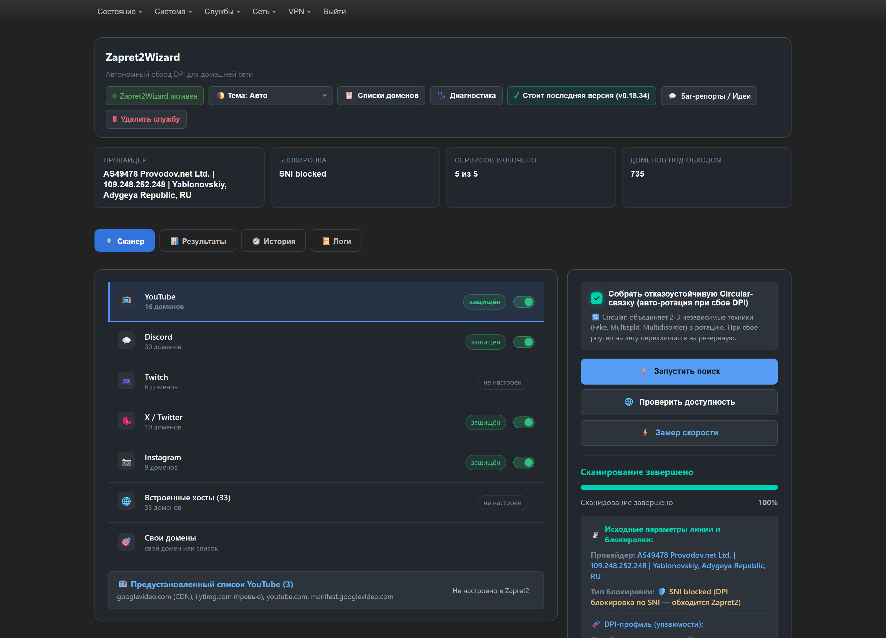
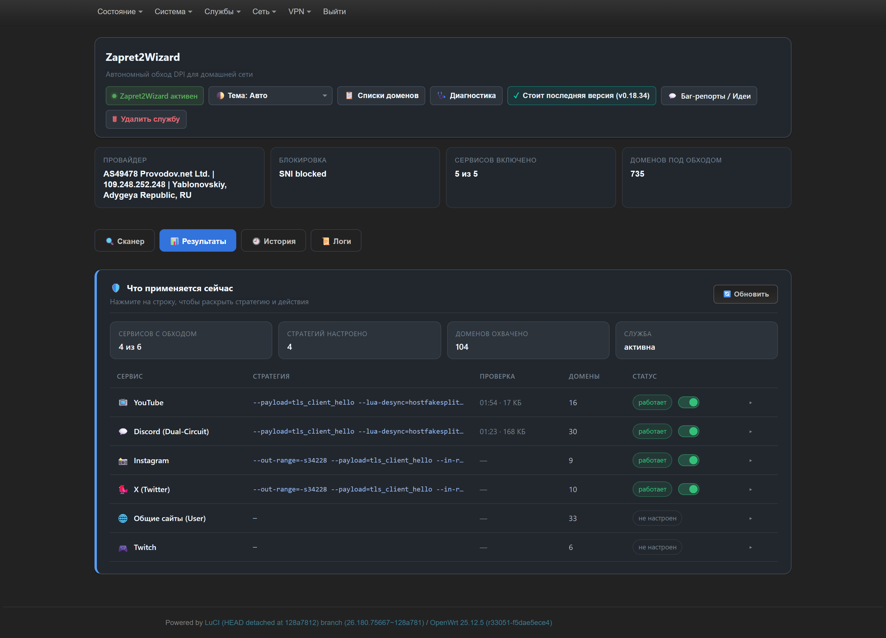
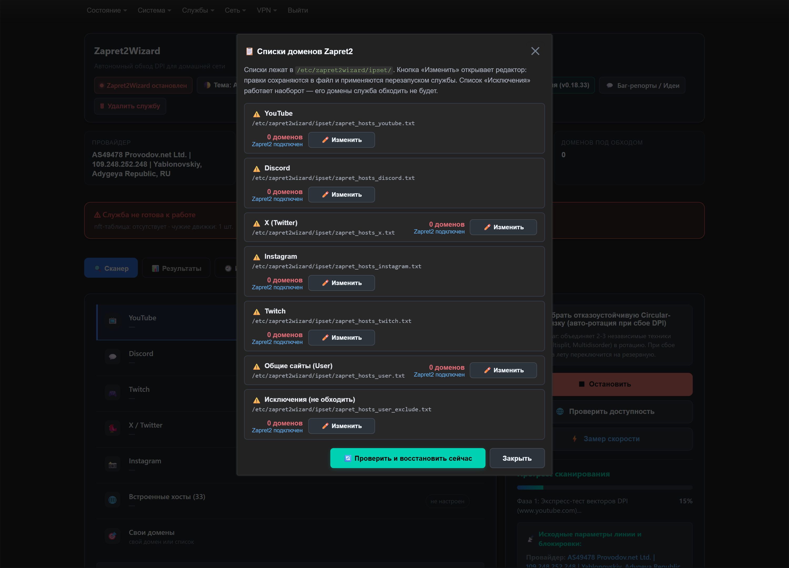
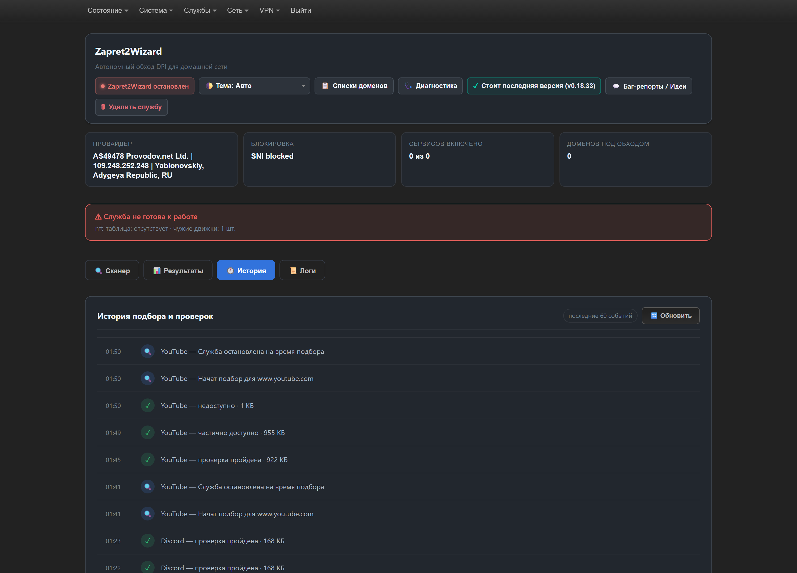
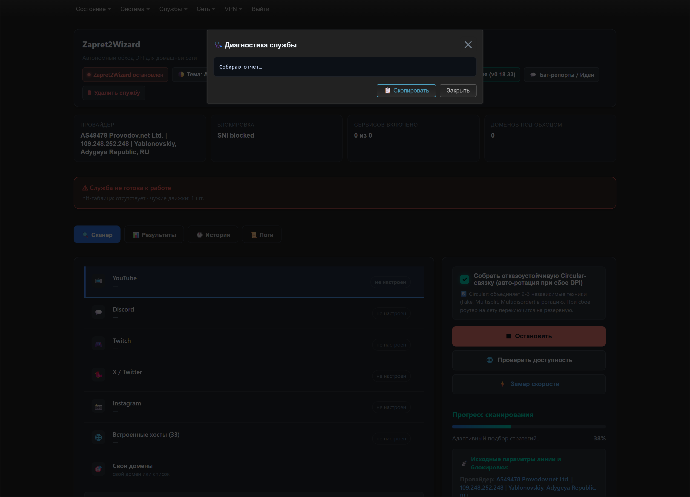

# Zapret2Wizard

**Автономный обход DPI/ТСПУ для OpenWrt:** движок `zapret2 (nfqws2)`, собственный сканер стратегий, подбор под конкретного провайдера и веб-интерфейс LuCI. Ставится одним пакетом, работает без сторонних зависимостей и без интернета после установки.

[](https://github.com/prostoy23rus/zapret2wizard/releases)
[](https://openwrt.org)
[](#поддерживаемые-архитектуры)
[](LICENSE)

<p align="center">
  
</p>

<p align="center"><i>Провайдер, тип блокировки, число включённых сервисов и доменов — на одном экране. У каждого сервиса свой переключатель.</i></p>

---

## Что это даёт

- **Обход работает для всех устройств в сети** — телефоны, ноутбуки, ТВ. Настраивается на роутере, клиенты ничего не ставят.
- **Стратегия подбирается под вашего провайдера.** Готовых универсальных стратегий не бывает: сканер проверяет кандидатов реальной загрузкой до 256 КБ и применяет только ту, что действительно пропускает трафик.
- **Обход только там, где нужно** — отдельные списки доменов для YouTube, Discord, Twitch, X, Instagram, плюс «Свои домены» и список исключений.
- **Самодиагностика**: `doctor`, `selftest`, `class` — показывают, что сломано и какой класс фильтрации у провайдера.
- **Живёт после перезагрузки**: автозапуск, восстановление после подбора, самоподъём службы.

## Установка

### Одной командой (SSH на роутере)

```sh
sh -c "$(curl -sSL https://raw.githubusercontent.com/prostoy23rus/zapret2wizard/main/install.sh)"
```

Если GitHub недоступен — то же через CDN:

```sh
sh -c "$(curl -sSL https://cdn.jsdelivr.net/gh/prostoy23rus/zapret2wizard@main/install.sh)"
```

Скрипт сам определит архитектуру, поставит зависимости, скачает движок, сканер и интерфейс, прогонит `preflight` и, если стратегий ещё нет, запустит автонастройку.

### Пакетами и бандлом

**Скачать:** [последний релиз](https://github.com/prostoy23rus/zapret2wizard/releases/latest) — там лежат `.apk`, `.ipk` и автономный бандл.

| Прошивка | Чем ставить | Команда |
|---|---|---|
| OpenWrt 25.x (apk) | `.apk` | `apk add --allow-untrusted /tmp/zapret2wizard_<версия>-r1_<арх>.apk` |
| OpenWrt 24.10 и старше (opkg) | `.ipk` | `opkg install --force-overwrite /tmp/luci-app-blockcheckw_<версия>-1_<арх>.ipk` |
| любая | автономный бандл | `tar -xzf bundle.tar.gz -C /tmp && cd /tmp/zapret2wizard-* && sh install.sh` |

Бандл и `.apk` **самодостаточны**: внутри LuCI-приложение, helper, сканер `blockcheckw`, движок `nfqws2`, списки доменов и пресеты стратегий.

Перед установкой бандл запускает **preflight** — проверяет прошивку, архитектуру, nftables, nfqueue, procd, память (≥ 60 МБ), свободное место (≥ 3 МБ), `curl`/`wget` и чужие движки DPI. Обойти: `SKIP_PREFLIGHT=1 sh install.sh`.

Если стратегий ещё нет, после установки автоматически стартует подбор для YouTube и Discord (`autosetup`, 5–20 минут). Отключить: `AUTOSETUP=0 sh install.sh`.

## Как это выглядит

### Результаты: что применяется сейчас

<p align="center">
  
</p>

Сервис, его стратегия, проверка (последний тест и объём), число доменов и статус. Строка раскрывается: параметры стратегии, кнопки «Проверить» и «Подобрать заново».

### Списки доменов

<p align="center">
  
</p>

Видно, какие списки подключены к zapret2, сколько в них доменов и что требует внимания. Списки редактируются прямо в интерфейсе: по одному домену в строке, после сохранения служба перезапускается.

### История и логи

<p align="center">
  
</p>

Все подборы, применения стратегий и переключения сервисов — с результатом и объёмом загрузки.

### Диагностика в один клик

<p align="center">
  
</p>

Кнопка «Диагностика» в шапке запускает `selftest` и показывает отчёт: версия, движки, очередь, flow offloading, живая проверка сервиса, DNS, контрольный сайт.

## Команды

```sh
blockcheckw-helper doctor      # окружение: nftables, движок, служба, права, автозапуск
blockcheckw-helper selftest    # живая проверка: статус, HTTP-код, байты, DNS, контрольный сайт
blockcheckw-helper class       # 9 базовых приёмов desync → класс ТСПУ и рекомендация
blockcheckw-helper autosetup   # подбор YouTube и Discord с нуля
blockcheckw-helper toggle <сервис>  # включить/выключить обход для сервиса
blockcheckw-helper update      # обновление с GitHub
```

`class` полезен, когда подбор не находит ничего: он показывает, какие механики провайдер пропускает, и подсказывает семейство стратегий.

## Что проверено

| Роутер | Прошивка | Провайдер | Результат |
|---|---|---|---|
| Cudy WR3000E | OpenWrt 25.12.5 (apk) | Provodov.net, Адыгея | YouTube 200 · ~870 КБ, Discord 200 · 170 КБ |
| RouteRich | OpenWrt 24.10 (opkg) | Краснодар | YouTube 200 · ~970 КБ, Discord 200 · 170 КБ, BBC/Facebook 200 |

Установка проверена двумя способами на одном и том же роутере: бандлом и пакетом `.apk` (включая обновление `0.18.31 → 0.18.34` с сохранением конфига).

## Если обход не работает

```sh
blockcheckw-helper selftest
```

| Симптом | Причина | Что делать |
|---|---|---|
| `движки nfqws2: 2` вместо 3 | каталоги `/etc/zapret2wizard` недоступны пользователю `daemon` | `chmod 755 /etc/zapret2wizard /etc/zapret2wizard/ipset`, `chmod 644 /etc/zapret2wizard/ipset/*.txt`, перезапуск службы |
| `http-код: 000`, байт 0 | десинк не применяется | `doctor`: должно быть `flow offloading OK отключён` |
| `status: degraded`, ответ рвётся на 16 КБ | ТСПУ режет поток | запустить подбор: кандидаты проверяются полной загрузкой, обрезанные отклоняются |
| подбор пишет «не найдено», но сервис открывается | подбор ищет **новые** варианты, текущая стратегия уже работает | это норма; сообщение теперь так и объясняет |
| всё зелёное, сайт не открывается | кэш браузера / QUIC | Ctrl+F5, отключить QUIC |

Полный разбор — в [docs/ZAPRET2-KNOWLEDGE.md](docs/ZAPRET2-KNOWLEDGE.md) и [skills/zapret2-desync/SKILL.md](skills/zapret2-desync/SKILL.md).

## Поддерживаемые архитектуры

Движок `nfqws2` в репозитории: `aarch64`, `arm`, `x86_64`, `mips`, `mipsel`, `mips64`, `riscv64`, `ppc`.
Сканер `blockcheckw` собирается CI под 6 архитектур; для остальных — из исходников по [docs/BUILD-AARCH64.md](docs/BUILD-AARCH64.md).

## Устройство проекта

```
src/                     Rust-сканер blockcheckw
openwrt/
  engine/                готовые nfqws2 под архитектуры
  luci-app-blockcheckw/  LuCI-приложение, helper, init-скрипт, Lua-модули, fake-блоб
  version.json           текущая версия и changelog
packaging/               сборка бандла, .apk, preflight
strategies/              пресеты стратегий (130+ кандидатов)
skills/, docs/           база знаний по zapret2 и гайды
.github/workflows/       CI: сканер и пакеты под 6 архитектур
```

## Благодарности

- [bol-van/zapret2](https://github.com/bol-van/zapret2) — движок `nfqws2` и Lua-библиотеки.
- [rcd27/blockcheckw](https://github.com/rcd27/blockcheckw) — исходный сканер, который вырос в этот проект.
- [saitkul/tspu-class-test](https://github.com/saitkul/tspu-class-test) — идея матрицы «класс ТСПУ».

## Лицензия

MIT — см. [LICENSE](LICENSE).
