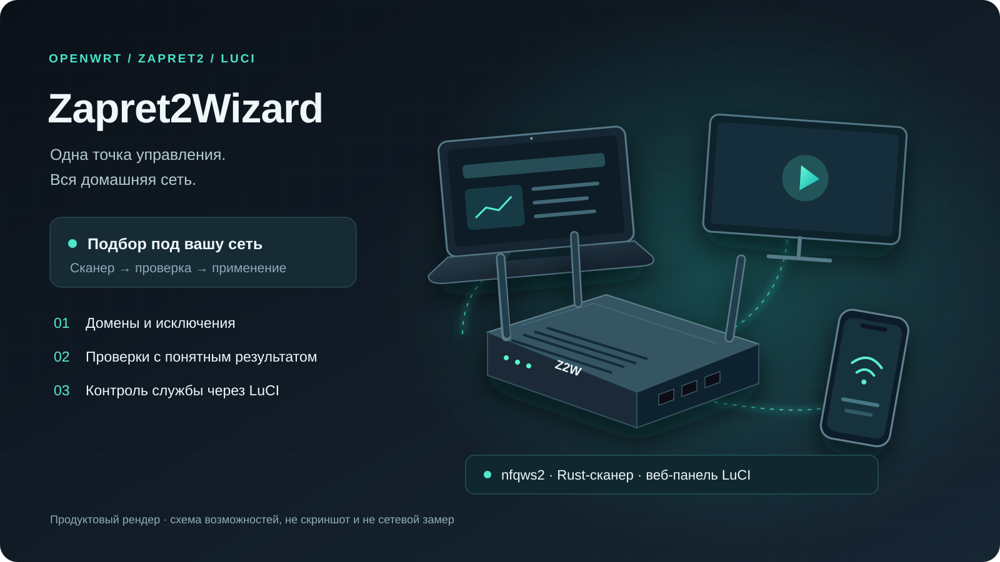
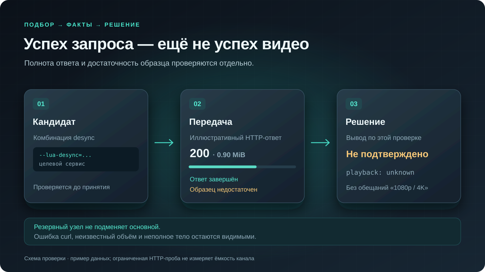
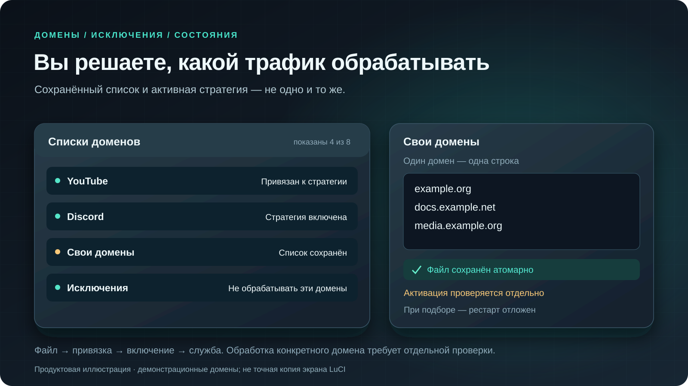
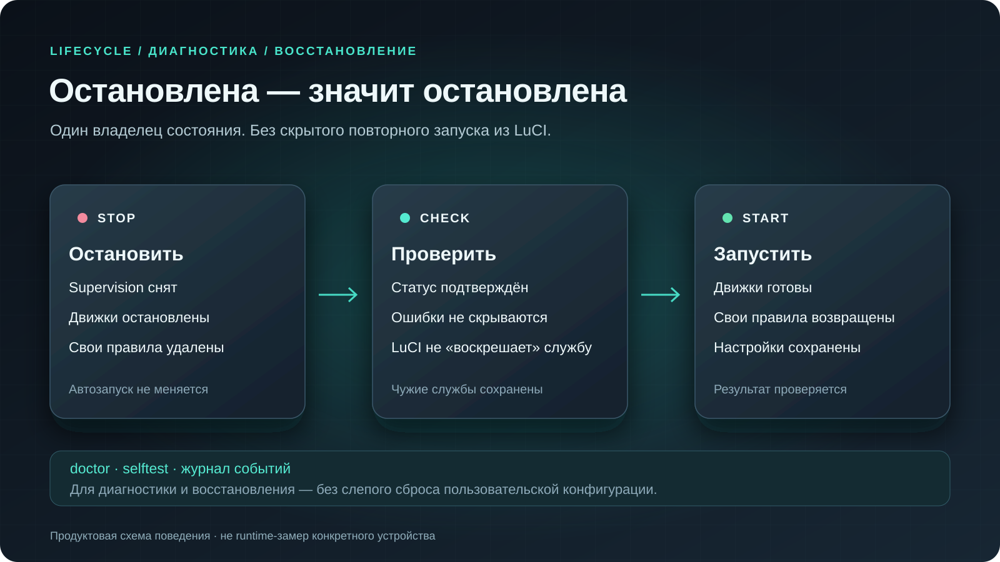

# Zapret2Wizard

**Контроль обхода DPI/ТСПУ на OpenWrt:** движок `zapret2 (nfqws2)`, Rust-сканер стратегий и веб-интерфейс LuCI в одном комплекте. Подбирайте кандидатов под свою сеть, управляйте доменами и проверяйте результат — без установки приложений на каждом устройстве. Системные зависимости устанавливаются отдельно пакетным менеджером; после установки обычная обработка трафика не требует доступа к GitHub.

[](https://github.com/prostoy23rus/zapret2wizard/releases)
[](https://openwrt.org)
[](#поддерживаемые-архитектуры)
[](<./LICENSE>)

<p align="center">
  <a href="./docs/images/hero-render.svg"></a>
</p>

<p align="center"><i>Четыре иллюстрации объясняют возможности и состояния приложения: это продуктовые схемы, не скриншоты и не результаты сетевых замеров. Нажмите на изображение, чтобы открыть его в полном размере.</i></p>

---

## Что это даёт

- **Настройка на роутере, а не на каждом устройстве.** Обработка трафика домашней сети — для телефонов, ноутбуков и ТВ, чей трафик проходит через роутер.
- **Поиск под вашу сеть.** Rust-сканер проверяет стратегии-кандидаты; перед применением выполняются дополнительные HTTP-пробы. Результат зависит от провайдера, маршрута и выбранных сервисов.
- **Вы выбираете домены.** Отдельные списки для YouTube, Discord, Twitch, X и Instagram, свои домены и глобальные исключения.
- **Управление в LuCI.** Проверка, подбор, списки, состояние службы и история — в веб-интерфейсе OpenWrt.
- **Диагностика вместо догадок.** `doctor`, `selftest` и `class` помогают проверить окружение, передачу данных и реакции сети на разные приёмы.
- **Собственный контур службы.** Своя nft-таблица и очереди, автозапуск через procd и восстановление после подбора. Совместимость с конкретным туннелем и маршрутизацией всё равно нужно проверять.

## Установка

### Одной командой (SSH на роутере)

```sh
sh -c "$(curl -sSL https://raw.githubusercontent.com/prostoy23rus/zapret2wizard/main/install.sh)"
```

Альтернативная установка через CDN, если GitHub недоступен:

```sh
sh -c "$(curl -sSL https://cdn.jsdelivr.net/gh/prostoy23rus/zapret2wizard@main/install.sh)"
```

Установщик определяет архитектуру, устанавливает системные зависимости и компоненты приложения, выполняет `preflight` и проверяет необходимость автонастройки. Для загрузки компонентов и зависимостей нужен доступ к источникам.

### Пакетами и бандлом

**Скачать:** [последний релиз](https://github.com/prostoy23rus/zapret2wizard/releases/latest) — там лежат `.apk`, `.ipk` и автономный бандл.

| Прошивка | Чем ставить | Команда |
|---|---|---|
| OpenWrt 25.x (apk) | `.apk` | `apk add --allow-untrusted /tmp/zapret2wizard_<версия>-r<ревизия>_<арх>.apk` |
| OpenWrt 24.10 и старше (opkg) | `.ipk` | `opkg install --force-overwrite /tmp/luci-app-blockcheckw_<версия>-1_<арх>.ipk` |
| совместимая OpenWrt | бандл | `tar -xzf bundle.tar.gz -C /tmp && cd /tmp/zapret2wizard-* && sh install.sh` |

Подставляйте точное имя скачанного файла, включая ревизию: проверенный ARM64-пакет 0.37.10 имеет `r3`, а не `r1`. Ревизия пакета может отличаться между сборками одной версии.

Бандл и `.apk` содержат LuCI-приложение, helper, сканер `blockcheckw`, движок `nfqws2`, списки доменов и пресеты. **Это не установка без зависимостей:** нужны системные пакеты OpenWrt, включая nftables/nfqueue, Lua и curl; возможность установки зависит от прошивки и её репозиториев.

Перед установкой бандл запускает **preflight**: проверяет платформу, nftables/nfqueue, procd, память, свободное место и средства загрузки; предупреждает о чужих движках DPI. Это предварительная проверка, а не гарантия совместимости.

При первичной настройке установщик может запустить фоновый подбор для YouTube и Discord (`autosetup`). Прогресс виден в LuCI → Службы → Zapret2Wizard; длительность зависит от сети. Отключить автоподбор в установщике: `AUTOSETUP=0 sh install.sh`.

<details>
<summary>Очистка остатков после удаления</summary>

Штатное удаление использует общий lifecycle для apk, opkg и бандла и проверяет результат, а не только запуск фоновой задачи. Если после удаления остались управляемые правила, используйте [очистку остатков](<./tools/cleanup-leftovers.sh>) **вместе с [модулем lifecycle](<./openwrt/luci-app-blockcheckw/root/usr/share/zapret2wizard/lifecycle.sh>)**. Одного скачанного shell-файла больше недостаточно. Если модуль уже удалён, распакуйте полные исходники на роутере:

```sh
wget -O /tmp/zapret2wizard-source.tar.gz https://github.com/prostoy23rus/zapret2wizard/archive/refs/heads/main.tar.gz
tar -xzf /tmp/zapret2wizard-source.tar.gz -C /tmp
sh /tmp/zapret2wizard-main/tools/cleanup-leftovers.sh
```

Очистка удаляет только принадлежащие приложению DNS-записи, QUIC/nft-правила и cron-задачи. Старые DNS-записи без доказанной принадлежности сохраняются: их нужно проверить вручную, а не удалять по совпадению домена. Пользовательские конфигурация и списки не являются целью очистки.

</details>

## Как это работает

### Проверка и применение стратегии

<p align="center">
  <a href="./docs/images/verification-render.svg"></a>
</p>

Сканер ищет кандидатов, а LuCI помогает проверить и применить выбранный вариант. В матрице сервисов видны стратегия, последняя проверка и списки доменов; строка раскрывает параметры и действия «Проверить» и «Подобрать заново».

HTTP-ответ, завершённая передача и достаточный контрольный образец — разные результаты. Основной и резервный пути оцениваются отдельно. Успешная проба не доказывает воспроизведение видео, а ограниченная загрузка не измеряет пропускную способность канала.

### Списки доменов

<p align="center">
  <a href="./docs/images/lists-render.svg"></a>
</p>

Редактируйте домены прямо в LuCI: по одному в строке. Для выбранных сервисов есть отдельные списки, для остальных — свои домены; глобальные исключения задают, что обходить не нужно.

Интерфейс различает сохранённый файл, привязку к стратегии и работающую службу. Сохранение атомарное, с проверкой ошибок и устаревшей ревизии; пустой список остаётся пустым. Во время сканирования активация откладывается, а ошибка рестарта не отменяет уже сохранённый файл. Привязка списка сама по себе не подтверждает его работу в живом трафике.

### Управление службой и диагностика

<p align="center">
  <a href="./docs/images/lifecycle-render.svg"></a>
</p>

Запускайте и останавливайте службу из LuCI. Остановка снимает supervision procd и управляемые правила; обычное открытие страницы или списков не должно включать остановленную службу. При удалении общий lifecycle-модуль очищает ресурсы, принадлежащие приложению.

Кнопка «Диагностика» запускает `selftest`: версия, процессы движков, nft-таблица, flow offloading, HTTP-проба, DNS и контрольный сайт. Во вкладке «История» собраны события проверок, подбора и применения — удобно сопоставлять изменение стратегии с результатом.

### История поиска и эволюция

«Эволюция» синтезирует новые комбинации, хранит геномы по провайдеру и показывает результаты и поколения. Это способ расширить поиск, а не обещание найти рабочий вариант.

Плановое обучение использует cron: `evolve_nightly` назначен на **06:10 по времени роутера** и может пропустить прогон, если сервис здоров или занят подбором. `health_tick` вызывается каждые 30 минут; два последовательных неуспеха могут запустить эволюцию, с ограничением автозапусков раз в 6 часов.

### Каталог геномов по ASN

В [каталоге геномов](<./genomes/>) можно обмениваться комбинациями для сети провайдера. Импорт не заменяет проверку в вашей сети.

```sh
blockcheckw-helper catalog_fetch            # определить ASN автоматически
blockcheckw-helper catalog_fetch AS25490    # указать ASN вручную
```

В LuCI доступны «Каталог по ASN» и экспорт геномов. Формат каталога и порядок отправки Pull Request — в [инструкции](<./genomes/README.md>).

## Команды

```sh
blockcheckw-helper doctor      # окружение: nftables, движок, служба, права, автозапуск
blockcheckw-helper selftest    # живая проверка: статус, HTTP-код, байты, DNS, контрольный сайт
blockcheckw-helper class       # сравнение 9 базовых приёмов desync
blockcheckw-helper youtube_audit   # веб + превью + API + CDN, с подсказкой
blockcheckw-helper quic_mode fake  # fake QUIC Initial вместо глобального reject
blockcheckw-helper netcheck    # CIDR-whitelist, обрезка 16 КБ, подмена DNS
blockcheckw-helper autosetup   # подбор YouTube и Discord с нуля
blockcheckw-helper evolve      # синтез новых комбинаций + память по провайдеру
blockcheckw-helper toggle <сервис>  # включить/выключить обход для сервиса
blockcheckw-helper update      # обновление с GitHub
```

`class` сравнивает базовые приёмы и помогает выбрать направление поиска. Это ориентир по реакции сети на пробы, а не точное определение оборудования провайдера.

Разбор эталонных репозиториев и выбранных техник: [docs/ANALYSIS-2026-11.md](<./docs/ANALYSIS-2026-11.md>).

## Что проверено

### Текущий релиз 0.37.11 — совместимость очистки cron с BusyBox awk

Исправлен синтаксис регулярного выражения в lifecycle-очистке cron, который не принимался Ubuntu `busybox-static` awk. Отбор по принадлежности приложению сохранён; подробности — в [примечаниях к 0.37.11](<./release_0.37.11.md>). **0.37.11 пока не проверена на реальном роутере**; результаты ниже относятся именно к исторической проверке 0.37.10-r3.

<details>
<summary>Историческая проверка 0.37.10-r3 и её ограничения</summary>

На **Routerich AX3000 v1 / OpenWrt 25.12.6** для пакета **0.37.10-r3** проверены остановка и повторный запуск службы, отсутствие автозапуска при открытии LuCI, редактор доменов и сохранение пользовательских рецептов. Это результаты конкретной версии на одном устройстве, не подтверждение всех прошивок и архитектур.

HTTP-пробы различали полную доставку и недостаточный образец; успешная резервная загрузка не подтверждала основной видеопуть. Интерактивное воспроизведение, перезагрузка и разрушительное удаление на роутере не проверялись. Детали, локальные регрессионные тесты и ограничения — в [примечаниях к 0.37.10](<./release_0.37.10.md>).

</details>

Проверки сканера, службы и упаковки описаны в [CI](<./.github/workflows/ci.yml>); [результаты запусков](https://github.com/prostoy23rus/zapret2wizard/actions) нужно смотреть для соответствующего коммита.

## Если обход не работает

Начните с окружения и контрольной пробы, а не со смены прав или готового рецепта:

```sh
blockcheckw-helper doctor
blockcheckw-helper selftest
blockcheckw-helper youtube_audit
```

- Сопоставьте службу, nft-правила, DNS, код HTTP и полноту передачи. Число процессов само по себе не устанавливает причину сбоя: учитывайте включённые профили и другие DPI-службы.
- Если контрольный запрос проходит, а сайт или видео — нет, проверьте запросы реального клиента и медиахосты. HTTP-успех не равен исправности браузера или воспроизведения.
- Если нужен новый вариант, запустите подбор в LuCI. Отсутствие кандидата не доказывает, что все способы исчерпаны; туннель и маршрут тоже влияют на результат.

Подробнее: [база знаний](<./docs/ZAPRET2-KNOWLEDGE.md>) и [приёмы zapret2](<./skills/zapret2-desync/SKILL.md>). При обращении в [Issues](https://github.com/prostoy23rus/zapret2wizard/issues) укажите версию пакета, модель роутера, прошивку и результаты диагностики, убрав личные данные.

## Поддерживаемые архитектуры

Движок `nfqws2` в репозитории: `aarch64`, `arm`, `x86_64`, `mips`, `mipsel`, `mips64`, `riscv64`, `ppc`.
Текущая [матрица сборки сканера и пакетов](<./.github/workflows/build.yml>) содержит **три** цели: `aarch64_cortex-a53`, `arm_cortex-a7`, `x86_64`. Наличие готового движка для другой архитектуры не означает наличие полного релизного пакета или проверку на устройстве. Сборка из исходников описана в [руководстве](<./docs/BUILD-AARCH64.md>).

## Устройство проекта

```
src/                     Rust-сканер blockcheckw
openwrt/
  engine/                готовые nfqws2 под архитектуры
  luci-app-blockcheckw/  LuCI-приложение, helper, init-скрипт, Lua-модули, fake-блоб
  version.json           текущая версия и changelog
packaging/               сборка бандла, .apk, preflight
strategies/              пресеты стратегий (130+ кандидатов)
skills/, docs/           база знаний по zapret2 и гайды
.github/workflows/       CI: сканер и пакеты под 3 архитектуры
```

## Благодарности

- [bol-van/zapret2](https://github.com/bol-van/zapret2) — движок `nfqws2` и Lua-библиотеки.
- [rcd27/blockcheckw](https://github.com/rcd27/blockcheckw) — исходный сканер, который вырос в этот проект.
- [saitkul/tspu-class-test](https://github.com/saitkul/tspu-class-test) — идея матрицы «класс ТСПУ».

## Лицензия

MIT — см. [LICENSE](<./LICENSE>).
