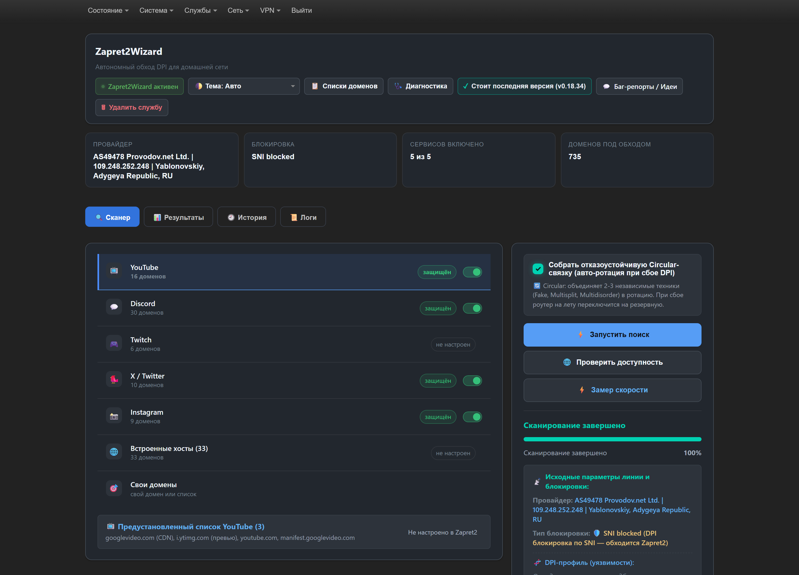
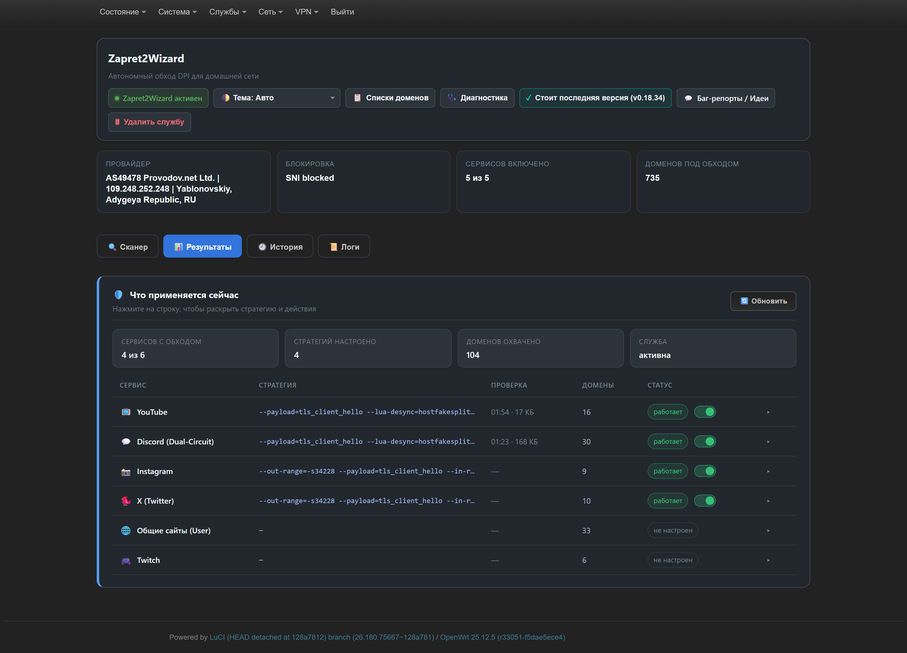
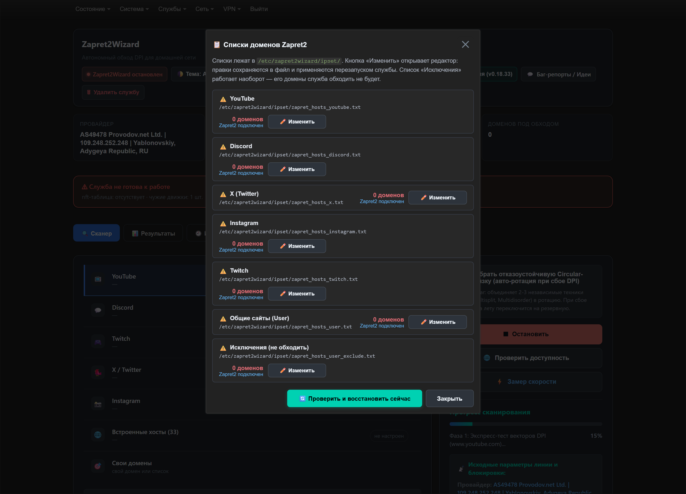
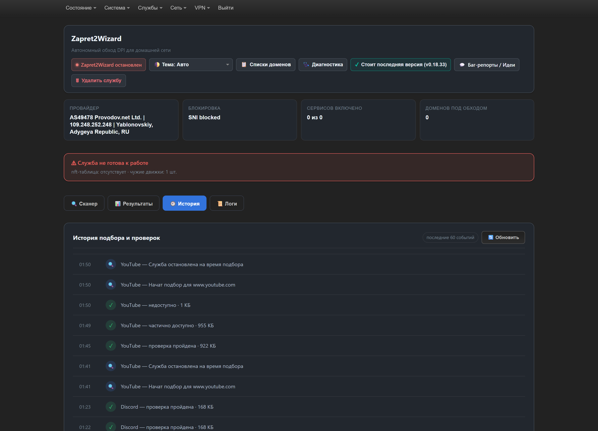
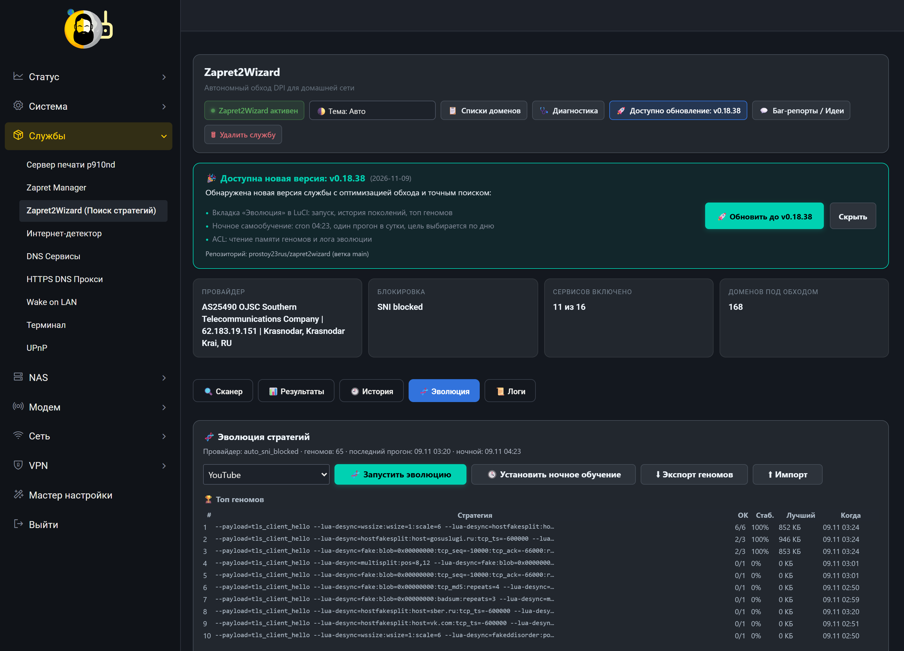
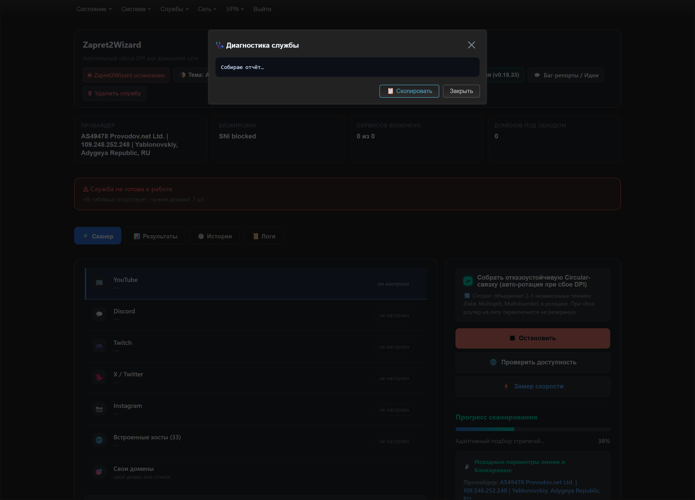

# Zapret2Wizard

**Автономный обход DPI/ТСПУ для OpenWrt:** движок `zapret2 (nfqws2)`, собственный сканер стратегий, подбор под конкретного провайдера и веб-интерфейс LuCI. Ставится одним пакетом, работает без сторонних зависимостей и без интернета после установки.

[](https://github.com/prostoy23rus/zapret2wizard/releases)
[](https://openwrt.org)
[](#поддерживаемые-архитектуры)
[](LICENSE)

<p align="center">
  
</p>

<p align="center"><i>Провайдер, тип блокировки, число включённых сервисов и доменов — на одном экране. У каждого сервиса свой переключатель.</i></p>

---

## Что это даёт

- **Обход работает для всех устройств в сети** — телефоны, ноутбуки, ТВ. Настраивается на роутере, клиенты ничего не ставят.
- **Стратегия подбирается под вашего провайдера.** Готовых универсальных стратегий не бывает: сканер проверяет кандидатов, а применение проходит дополнительные HTTP-проверки. Достижимость узла, завершённая передача и достаточный контрольный образец — разные результаты; короткий успешный ответ не доказывает воспроизведение видео.
- **Обход только там, где нужно** — отдельные списки доменов для YouTube, Discord, Twitch, X, Instagram, плюс «Свои домены» и список исключений.
- **Не конфликтует с туннелями** — служба работает в своей nft-таблице и своих очередях, не пишет в чужие списки и не останавливает чужие службы; если домен заворачивается в туннель, подбор честно об этом скажет.
- **Самодиагностика**: `doctor`, `selftest`, `class` — показывают, что сломано и какой класс фильтрации у провайдера.
- **Живёт после перезагрузки**: автозапуск, восстановление после подбора, самоподъём службы.

## Установка

### Одной командой (SSH на роутере)

```sh
sh -c "$(curl -sSL https://raw.githubusercontent.com/prostoy23rus/zapret2wizard/main/install.sh)"
```

### Если после удаления остались следы

Штатное удаление использует общий lifecycle для apk, opkg и бандла и проверяет результат, а не только запуск фоновой задачи. Если после удаления остались управляемые правила, используйте [очистку остатков](tools/cleanup-leftovers.sh) **вместе с [модулем lifecycle](openwrt/luci-app-blockcheckw/root/usr/share/zapret2wizard/lifecycle.sh)**. Одного скачанного shell-файла больше недостаточно. Если модуль уже удалён, распакуйте полные исходники на роутере:

```sh
wget -O /tmp/zapret2wizard-source.tar.gz https://github.com/prostoy23rus/zapret2wizard/archive/refs/heads/main.tar.gz
tar -xzf /tmp/zapret2wizard-source.tar.gz -C /tmp
sh /tmp/zapret2wizard-main/tools/cleanup-leftovers.sh
```

Очистка удаляет только принадлежащие приложению DNS-записи, QUIC/nft-правила и cron-задачи. Старые DNS-записи без доказанной принадлежности сохраняются: их нужно проверить вручную, а не удалять по совпадению домена. Пользовательские конфигурация и списки не являются целью очистки.

Альтернативная установка через CDN, если GitHub недоступен:

```sh
sh -c "$(curl -sSL https://cdn.jsdelivr.net/gh/prostoy23rus/zapret2wizard@main/install.sh)"
```

Скрипт сам определит архитектуру, поставит зависимости, скачает движок, сканер и интерфейс, прогонит `preflight` и, если стратегий ещё нет, запустит автонастройку.

### Пакетами и бандлом

**Скачать:** [последний релиз](https://github.com/prostoy23rus/zapret2wizard/releases/latest) — там лежат `.apk`, `.ipk` и автономный бандл.

| Прошивка | Чем ставить | Команда |
|---|---|---|
| OpenWrt 25.x (apk) | `.apk` | `apk add --allow-untrusted /tmp/zapret2wizard_<версия>-r<ревизия>_<арх>.apk` |
| OpenWrt 24.10 и старше (opkg) | `.ipk` | `opkg install --force-overwrite /tmp/luci-app-blockcheckw_<версия>-1_<арх>.ipk` |
| любая | автономный бандл | `tar -xzf bundle.tar.gz -C /tmp && cd /tmp/zapret2wizard-* && sh install.sh` |

Подставляйте точное имя скачанного файла, включая ревизию: проверенный ARM64-пакет 0.37.10 имеет `r3`, а не `r1`. Ревизия пакета может отличаться между сборками одной версии.

Бандл и `.apk` **самодостаточны**: внутри LuCI-приложение, helper, сканер `blockcheckw`, движок `nfqws2`, списки доменов и пресеты стратегий.

Перед установкой бандл запускает **preflight** — проверяет прошивку, архитектуру, nftables, nfqueue, procd, память (≥ 60 МБ), свободное место (≥ 3 МБ), `curl`/`wget` и чужие движки DPI. Обойти: `SKIP_PREFLIGHT=1 sh install.sh`.

Если стратегий ещё нет, после установки автоматически стартует подбор для YouTube и Discord (`autosetup`, 5–20 минут). Отключить: `AUTOSETUP=0 sh install.sh`.

## Как это выглядит

### Результаты: что применяется сейчас

<p align="center">
  
</p>

Сервис, его стратегия, проверка (последний тест и объём), число доменов и статус. Строка раскрывается: параметры стратегии, кнопки «Проверить» и «Подобрать заново».

### Списки доменов

<p align="center">
  
</p>

LuCI отдельно показывает наличие файла, привязку к стратегии, включение стратегии и состояние службы. «Привязан» не означает, что эта ревизия списка уже проверена в живом трафике; предупреждения видны и без открытия редактора.

Списки редактируются прямо в интерфейсе: по одному домену в строке. Сохранение атомарное, с проверкой ошибок записи и устаревшей ревизии. Сохранённый файл, запуск рестарта и готовность службы — разные состояния; во время сканирования активация откладывается. При ошибке рестарта интерфейс не выдаёт файл за несохранённый. Намеренно очищенные списки остаются пустыми после повторного чтения; пустой список возвращается как `count: 0`, `domains: []`.

### История и логи

<p align="center">
  
</p>

Все подборы, применения стратегий и переключения сервисов — с результатом и объёмом загрузки.

### Эволюция стратегий

<p align="center">
  
</p>

Вкладка «🧬 Эволюция» запускает синтез новых комбинаций, показывает топ геномов (успехи, стабильность, лучший объём) и историю поколений. Кнопка «Установить ночное обучение» включает cron-задачу: раз в сутки в 04:23 один прогон на выбранном по дню сервисе.

### Каталог геномов по ASN

В репозитории появился [`genomes/`](genomes/) — общий каталог рабочих комбинаций по провайдерам.

```sh
blockcheckw-helper catalog_fetch            # ASN определится сам
blockcheckw-helper catalog_fetch AS25490    # или вручную
```

На вкладке «Эволюция» — кнопка «🌐 Каталог по ASN». Импорт сливает геномы по хешу аргументов: без дублей, берутся лучшие `ok`/`best`/`stability`.

Поделиться своими: «⬇ Экспорт геномов» → файл `bcw-genomes-<ASN>.json` → положить в `genomes/AS<ASN>.json` → Pull Request. Формат и инструкция — в [genomes/README.md](genomes/README.md).

Дневной триггер: cron каждые 30 минут запускает `health_tick`. Если сервис деградировал два замера подряд — автоматически запускается эволюция (не чаще одного раза в 6 часов).

### Диагностика в один клик

<p align="center">
  
</p>

Кнопка «Диагностика» в шапке запускает `selftest` и показывает отчёт: версия, движки, очередь, flow offloading, живая проверка сервиса, DNS, контрольный сайт.

## Команды

```sh
blockcheckw-helper doctor      # окружение: nftables, движок, служба, права, автозапуск
blockcheckw-helper selftest    # живая проверка: статус, HTTP-код, байты, DNS, контрольный сайт
blockcheckw-helper class       # 9 базовых приёмов desync → класс ТСПУ и рекомендация
blockcheckw-helper youtube_audit   # веб + превью + API + CDN, с подсказкой
blockcheckw-helper quic_mode fake  # fake QUIC Initial вместо глобального reject
blockcheckw-helper netcheck    # CIDR-whitelist, обрезка 16 КБ, подмена DNS
blockcheckw-helper autosetup   # подбор YouTube и Discord с нуля
blockcheckw-helper evolve      # синтез новых комбинаций + память по провайдеру
blockcheckw-helper toggle <сервис>  # включить/выключить обход для сервиса
blockcheckw-helper update      # обновление с GitHub
```

`class` полезен, когда подбор не находит ничего: он показывает, какие механики провайдер пропускает, и подсказывает семейство стратегий.

Разбор эталонных репозиториев и выбранных техник: [docs/ANALYSIS-2026-11.md](docs/ANALYSIS-2026-11.md).

## Что проверено

### Текущий релиз 0.37.11 — совместимость очистки cron с BusyBox awk

Исправлен синтаксис регулярного выражения в lifecycle-очистке cron, который не принимался Ubuntu `busybox-static` awk. Отбор по принадлежности приложению сохранён; подробности — в [примечаниях к 0.37.11](release_0.37.11.md). **0.37.11 пока не проверена на реальном роутере**; результаты ниже относятся именно к исторической проверке 0.37.10-r3.

### 0.37.10 — историческая проверка исправлений службы и достоверности проб

На **Routerich AX3000 v1, OpenWrt 25.12.6** проверен пакет **0.37.10-r3**: Stop снимает supervision и собственные правила без возврата движков после прежнего интервала respawn; открытие LuCI/списков не запускает службу; Start возвращает три экземпляра `nfqws2`. Проверены Lua 5.1, curl-loopback и пустые списки в отдельной тестовой папке; реальный редактор User открывается в Chrome без ошибки JavaScript.

Пользовательские рецепты и их `enabled` сохранены; ожидаемое изменение конфигурации — **четыре привязки глобальных исключений** к управляемым стратегиям. Сеть, DHCP, cron и hosts сохранены; изменения firewall ограничены управляемым QUIC.

HTTP-проверка честно отклонила недостаточный образец: главная страница YouTube доставлена полностью (941823 байта), но порог образца не достигнут; `all_ok=false`, `playback=unknown`. Ответ manifest 404 и успешная резервная загрузка не подтверждают основной видеопуть. `optimal` означает только выполнение требований данной проверки, **не воспроизведение**; ограниченная по объёму/времени/скорости проба **не измеряет ёмкость канала**.

На этом устройстве не выполнялись разрушительное удаление пакета, перезагрузка и интерактивное воспроизведение видео. Удаление проверено изолированными тестами; свежая установка на всех архитектурах не подтверждена. Подробности R1–R12, проверки и ограничения — в [примечаниях к 0.37.10](release_0.37.10.md).

### Ранее опубликованные результаты (не проверка воспроизведения в 0.37.10)

| Роутер | Прошивка | Провайдер | Результат |
|---|---|---|---|
| Cudy WR3000E | OpenWrt 25.12.5 (apk) | Provodov.net, Адыгея | YouTube 200 · ~870 КБ, Discord 200 · 170 КБ |
| RouteRich | OpenWrt 24.10 (opkg) | Краснодар | YouTube 200 · ~970 КБ, Discord 200 · 170 КБ, BBC/Facebook 200 |
| RouteRich 24.10.8 (RR-3.12.4) | opkg, 0.18.79 → 0.19.2 | Ростелеком, AS12389 | youtube_audit 4/4 (веб 200 · 870 КБ, превью 200, API 405, CDN 200), конфиг пережил обновление |
| RouteRich 25.12.6 (RR-4.6.4) | apk, 0.19.2 | МТС, AS25513 | YouTube через zapret2wizard при работающем ZeroBlock: видео 2 МБ за 9 с, чужие службы не останавливаются |

Установка проверена двумя способами на одном и том же роутере: бандлом и пакетом `.apk` (включая обновление `0.18.31 → 0.18.34` с сохранением конфига).

Сканер и служба проверяются `tools/test_scanner_pipeline.sh`, `tools/test_ci_smoke.sh` и job `openwrt-scripts` в CI (busybox `ash -n`, структура пакета, netns-тесты).

## Если обход не работает

```sh
blockcheckw-helper selftest
```

| Симптом | Причина | Что делать |
|---|---|---|
| `движки nfqws2: 2` вместо 3 | каталоги `/etc/zapret2wizard` недоступны пользователю `daemon` | `chmod 755 /etc/zapret2wizard /etc/zapret2wizard/ipset`, `chmod 644 /etc/zapret2wizard/ipset/*.txt`, перезапуск службы |
| `http-код: 000`, байт 0 | HTTP-ответ не получен; возможны DNS, TLS, маршрут, таймаут или фильтрация | проверить код/ошибку curl и `doctor`; состояние flow offloading — один из факторов, а не доказательство причины |
| `status: degraded`, ответ рвётся на 16 КБ | незавершённая передача; одной пробы недостаточно для вывода о причине | проверить код curl, HTTP и полноту ответа, затем запустить подбор; обрыв не должен получать `optimal` |
| подбор пишет «не найдено», но сервис открывается | подбор ищет **новые** варианты, текущая стратегия уже работает | это норма; сообщение теперь так и объясняет |
| HTTP-проверка успешна, но сайт или видео не работают | контрольный образец не покрывает браузер, авторизацию и все медиахосты | проверить реальное воспроизведение и запросы клиента; затем кэш браузера / QUIC; успех HTTP не равен исправности видео |
| Видео YouTube не играет, а превью грузятся | стратегия проходит рукопожатие, но видео-хосты режутся | пересоберите стратегию или примените `multidisorder:pos=1,sniext+1,host+1,midsld`; проверьте `youtube_audit` и `quic_mode reject` |

Полный разбор — в [docs/ZAPRET2-KNOWLEDGE.md](docs/ZAPRET2-KNOWLEDGE.md) и [skills/zapret2-desync/SKILL.md](skills/zapret2-desync/SKILL.md).

## Поддерживаемые архитектуры

Движок `nfqws2` в репозитории: `aarch64`, `arm`, `x86_64`, `mips`, `mipsel`, `mips64`, `riscv64`, `ppc`.
Текущая [матрица сборки сканера и пакетов](.github/workflows/build.yml) содержит **три** цели: `aarch64_cortex-a53`, `arm_cortex-a7`, `x86_64`. Наличие готового движка для другой архитектуры не означает наличие полного релизного пакета или проверку на устройстве. Сборка из исходников описана в [руководстве](docs/BUILD-AARCH64.md).

## Устройство проекта

```
src/                     Rust-сканер blockcheckw
openwrt/
  engine/                готовые nfqws2 под архитектуры
  luci-app-blockcheckw/  LuCI-приложение, helper, init-скрипт, Lua-модули, fake-блоб
  version.json           текущая версия и changelog
packaging/               сборка бандла, .apk, preflight
strategies/              пресеты стратегий (130+ кандидатов)
skills/, docs/           база знаний по zapret2 и гайды
.github/workflows/       CI: сканер и пакеты под 3 архитектуры
```

## Благодарности

- [bol-van/zapret2](https://github.com/bol-van/zapret2) — движок `nfqws2` и Lua-библиотеки.
- [rcd27/blockcheckw](https://github.com/rcd27/blockcheckw) — исходный сканер, который вырос в этот проект.
- [saitkul/tspu-class-test](https://github.com/saitkul/tspu-class-test) — идея матрицы «класс ТСПУ».

## Лицензия

MIT — см. [LICENSE](LICENSE).
