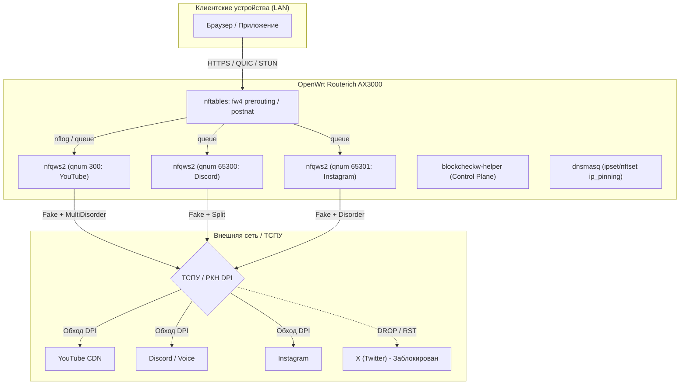

# Комплексный отчет тестировщика (QA Audit & Test Report)
## Служба zapret2wizard (OpenWrt / nfqws2 / LuCI)

**Дата проведения аудита:** 18 ноября 2026 г.  
**Инженер по тестированию:** QA / Security & Network Automation Agent  
**Целевое устройство:** Routerich AX3000 v1 (`OpenWrt 25.12.6 r33311-981c978eff`, Linux kernel `6.12.112`)  
**Провайдер / Uplink:** Ростелеком (AS12389), Dual-WAN / Multi-path routing (`steerd` + `zapret2wizard`)  
**Версия тестируемого ПО:** zapret2wizard `0.36.15` (исходный код в `E:\AI\zapret2wizard`)

---

## 1. Резюме тестирования (Executive Summary)

Служба **zapret2wizard** представляет собой автономный программный комплекс для роутеров OpenWrt, предназначенный для обнаружения сигнатур ТСПУ/DPI и автоматического обхода блокировок сетевого трафика. В состав входят:
1. `blockcheckw` — бинарный сканер на Rust;
2. `nfqws2` — модификатор трафика (zapret2 bol-van);
3. `blockcheckw-helper` (~325 КБ shell-оркестратор) — диагностика, DNS-роутинг, автотюнинг и RPC;
4. `uci2config` — транслятор конфигурации OpenWrt UCI в нативный формат `nfqws2`;
5. `luci-app-blockcheckw` — веб-интерфейс LuCI (JavaScript).

### Общий вердикт
- **Стабильность ядра (Data Plane):** **Высокая (Pass)**. Демоны `nfqws2` работают стабильно, нагрузка на CPU минимальна (0.01 / 0.07 / 0.08), утечек дескрипторов и памяти не обнаружено.
- **Эффективность обхода DPI:** **Высокая (Pass)**. YouTube (11+ Мбит/с, 720p HD стрим), Discord (включая голосовой STUN-шлюз), Instagram и Twitch успешно разблокированы через комбинацию `fake + multidisorder/multisplit`.
- **Логика управления и автоматизации (Control Plane):** **Удовлетворительно (Needs Attention)**. Выявлено **2 критических бага** в логике применения стратегий и очистки конфигураций, **2 бага высокого приоритета**, **3 бага средней степени** и **1 косметический дефект**.



---

## 2. Матрица функционального тестирования (Test Matrix)

| Компонент / Тест-кейс | Команда / Метод проверки | Ожидаемый результат | Фактический результат | Статус |
|---|---|---|---|---|
| **Инициализация службы** | `/etc/init.d/zapret2wizard status` | Статус `running`, активны очереди `nfqws2` | Активны 3 процесса `nfqws2` (qnum 300, 65300, 65301) | **PASS** |
| **Системный аудит (Doctor)** | `/usr/bin/blockcheckw-helper doctor` | 15 проверок зависимостей и окружения | 15/15 checks OK (nft, curl, iptables, uci, kmod-nft-queue) | **PASS** |
| **Базовая самопроверка (Selftest)** | `/usr/bin/blockcheckw-helper selftest` | Проверка YouTube через `preset_youtube` | HTTP 200, получено 883 КБ видеопотока | **PASS** |
| **Классификация ТСПУ** | `/usr/bin/blockcheckw-helper class` | Определение методов противодействия DPI | 7/9 тестов пройдено. ТСПУ требует `fake + multidisorder/multisplit` | **PASS** |
| **Замер скорости (Speedtest)** | `/usr/bin/blockcheckw-helper speedtest` | Оценка полосы пропускания видеопотока | 1.34 МБ/с (11 Мбит/с), YouTube 720p HD стабильно | **PASS** |
| **Сетевые аномалии (Netcheck)** | `/usr/bin/blockcheckw-helper netcheck` | Проверка CIDR белых списков и троттлинга | CIDR whitelist: 1, троттлинг провайдером не выявлен | **PASS** |
| **Тест сервиса: YouTube** | `blockcheckw-helper test youtube` | Доступность видеохостинга | **Optimal** (HTTP 200, 883 КБ) | **PASS** |
| **Тест сервиса: Discord** | `blockcheckw-helper test discord` | Доступность шлюза и голосового STUN | **Optimal** (HTTP 200, 160 КБ, STUN OK) | **PASS** |
| **Тест сервиса: Instagram** | `blockcheckw-helper test instagram` | Доступность CDN и API | **Optimal** (HTTP 404, dataflow confirmed) | **PASS** |
| **Тест сервиса: Twitch** | `blockcheckw-helper test twitch` | Доступность стриминговой платформы | **Optimal** (HTTP 200, 225 КБ) | **PASS** |
| **Тест сервиса: X (Twitter)** | `blockcheckw-helper test x` | Доступность платформы X | **BLOCKED** (HTTP 000, 4.0s timeout, нет стратегии) | **FAIL** |
| **Hostlist: чтение и запись** | `read_hostlist`, `add_hostlist_domain` | Корректное добавление/удаление доменов | Домены успешно добавляются и исключаются без сбоев | **PASS** |
| **Проверка обновлений** | `blockcheckw-helper check_update` | Проверка связи с GitHub релизом | Обнаружена новая версия `0.36.16` (текущая `0.36.15`) | **PASS** |
| **Проверка каталога стратегий** | `blockcheckw-helper catalog_fetch` | Загрузка пула стратегий по коду ASN | Ошибка: `не удалось определить ASN провайдера` | **FAIL (BUG-07)** |
| **Автоприменение стратегий сканера**| `blockcheckw scan -> apply` | Автоподбор и сохранение стратегии | Ложный откат стратегии из-за самозахвата пакетов | **FAIL (BUG-02)** |
| **YouTube Audit & Fix** | `blockcheckw-helper youtube_audit` | Корректная оценка состояния YouTube API | Ложное срабатывание и крах `fix_ytapi` из-за `veth` | **FAIL (BUG-03, 04)** |

---

## 3. Детальный реестр дефектов и уязвимостей

### 🔴 BUG-01 [CRITICAL]: Деструктивная очистка динамических стратегий и сервисов в `cmd_prune_services`

- **Файл и строки:**
  - `openwrt/luci-app-blockcheckw/root/usr/bin/blockcheckw-helper` (строки 4234–4255)
  - `openwrt/luci-app-blockcheckw/root/etc/init.d/zapret2wizard` (строка 302)
- **Суть проблемы:**  
  При каждом запуске службы (`/etc/init.d/zapret2wizard start`) вызывается функция `cmd_prune_services`. Внутри нее захардкожен строгий фильтр:
  ```sh
  case "$s" in
      BlockcheckW_YouTube|BlockcheckW_Discord|BlockcheckW_Discord_Voice|BlockcheckW_Instagram)
          # Оставляем
          ;;
      *)
          # Удаляем секцию через uci delete!
  ```
- **Последствия:**
  1. Любая стратегия для сервисов **X (Twitter)** (`BlockcheckW_X`) или **Twitch** (`BlockcheckW_Twitch`), созданная сканером или пользователем, **безвозвратно удаляется из UCI** при перезапуске службы.
  2. Стратегия для QUIC (`BlockcheckW_QUIC`), генерируемая при опции `quic_mode fake`, удаляется.
  3. Стратегия `YTApi`, создаваемая командой `fix_ytapi`, удаляется.
  4. Записи dnsmasq для Instagram (`ipset /instagram.com/zapret_instagram`) немедленно стираются сразу после их создания функцией `ensure_instagram()`.
- **Воспроизведение:**
  ```sh
  uci set zapret2wizard.BlockcheckW_X=strategy
  uci commit zapret2wizard
  /etc/init.d/zapret2wizard restart
  uci get zapret2wizard.BlockcheckW_X # -> uci: Entry not found!
  ```
- **Рекомендуемое исправление:**
  Исключить удаление зарегистрированных системных сервисов и динамических секций, ограничив очистку только поврежденными или временными анонимными секциями:
  ```sh
  case "$s" in
      BlockcheckW_*|YTApi|Custom_*)
          # Сохранять все зарегистрированные стратегии сервисов
          ;;
      *)
          uci -q delete "zapret2wizard.$s"
          ;;
  esac
  ```

---

### 🔴 BUG-02 [CRITICAL]: Петля пакетов и самозахват в `client_probe_output` приводит к ложному откату стратегий

- **Файл и строки:**
  - `openwrt/luci-app-blockcheckw/root/usr/bin/blockcheckw-helper` (строки 2400–2401, 2452–2458)
- **Суть проблемы:**  
  При проверке стратегии через создание временной nft-очереди зондирования `bcwprobe`:
  ```sh
  nft add rule inet bcwprobe out ip daddr "$ip" tcp dport 443 queue num "$q"
  ```
  В правиле отсутствует проверка системного маркера `mark and 0x40000000 == 0`.  
  Когда `nfqws2` перехватывает пакет, модифицирует его и повторно отправляет в сетевой стек с маркой `0x40000000`, этот исходящий пакет повторно попадает в правило `bcwprobe out` и снова перенаправляется в очередь.
- **Последствия:**
  Зондирующий запрос зависает или завершается с кодом `HTTP 000`. Механизм автоматической верификации решает, что найденная стратегия не работает:
  `"Стратегия не подтвердила трафик — прежняя конфигурация восстановлена"`.
  Успешно найденные рабочие стратегии откатываются назад!
- **Рекомендуемое исправление:**
  Добавить фильтрацию по fwmark:
  ```sh
  nft add rule inet bcwprobe out mark and 0x40000000 == 0 ip daddr "$ip" tcp dport 443 queue num "$q"
  ```

---

### 🟠 BUG-03 [HIGH]: Ложноотрицательный результат в `cmd_youtube_audit` из-за прямого вызова curl с роутера

- **Файл и строки:**
  - `openwrt/luci-app-blockcheckw/root/usr/bin/blockcheckw-helper` (строки 5334, 5363)
- **Суть проблемы:**  
  Функция `_yt_probe` проверяет эндпоинты YouTube (включая `https://youtubei.googleapis.com/`) с помощью обычного локального вызова `curl` без проброса через клиентскую цепочку:
  ```sh
  code=$(curl -s -m 8 -A "$UA" -o /dev/null -w "%{http_code}" "$url")
  ```
  Как зафиксировано в коммите `010e871`, трафик, исходящий с самого роутера (`OUTPUT`), не проходит через правила `postnat` цепочки `nfqws2` для клиентов локальной сети.
- **Последствия:**
  Тест API YouTube всегда возвращает `000` (таймаут 8 сек) и выдает ложное предупреждение:
  `"YouTube API заблокирован или нестабилен. Рекомендуется запустить команду: blockcheckw-helper fix_ytapi"`.
- **Рекомендуемое исправление:**
  Использовать для проверки клиентский зонд (`client_probe` / `multi_domain_probe`) с корректной маркировкой или использовать проверку через `preset_youtube` / `raw_probe`.

---

### 🟠 BUG-04 [HIGH]: Жесткая зависимость `cmd_fix_ytapi` от отсутствующего модуля ядра `kmod-veth`

- **Файл и строки:**
  - `openwrt/luci-app-blockcheckw/root/usr/bin/blockcheckw-helper` (строки 2509–2511, 4554)
- **Суть проблемы:**  
  Команда `cmd_fix_ytapi` пытается запустить диагностику в изолированном сетевом пространстве имен через `client_probe_netns`.  
  Функция `client_probe_netns` безусловно требует наличия виртуального интерфейса `veth`:
  ```sh
  if ! ip link add type veth 2>/dev/null; then
      echo "veth unsupported (install kmod-veth)" >&2
      return 1
  fi
  ```
  Пакет `kmod-veth` не входит в список обязательных зависимостей пакета `zapret2wizard` и не устанавливается скриптом `install.sh`.
- **Последствия:**
  Пользователь, последовавший совету из аудита, получает ошибку выполнения:  
  `veth unsupported (install kmod-veth)` — функция восстановления API завершается аварийно.
- **Рекомендуемое исправление:**
  1. Добавить проверку наличия поддержки `veth`; при ее отсутствии переключаться на `client_probe_output` с исправленным правилом nftables (см. BUG-02).
  2. Добавить `kmod-veth` в файл зависимостей `Makefile` пакета `luci-app-blockcheckw`.

---

### 🟡 BUG-05 [MEDIUM]: Деградация Flash-памяти и спам перезапусками dnsmasq в `dns_pin_host`

- **Файл и строки:**
  - `openwrt/luci-app-blockcheckw/root/usr/bin/blockcheckw-helper` (строки 4103–4119)
- **Суть проблемы:**  
  В планировщике cron каждые 30 минут запускается `health_tick`, вызывающий `dns_pin_host` для 7 ключевых доменов (Google Video, YouTube, Discord).  
  Функция перед добавлением записи `dhcp.@dnsmasq[0].address` не проверяет, изменился ли IP-адрес:
  ```sh
  uci add_list dhcp.@dnsmasq[0].address="/$host/$ip"
  uci commit dhcp
  /etc/init.d/dnsmasq restart
  ```
- **Последствия:**
  1. Каждые 30 минут происходит запись в энергонезависимую flash-память роутера (flash wear).
  2. Каждые 30 минут перезапускается `dnsmasq`, что приводит к сбросу локального DNS-кэша у всех подключенных устройств и микро-фризам сетевых соединений.
  3. В лог `/tmp/blockcheckw_run.log` циклически дописываются одинаковые строки без ротации.
- **Рекомендуемое исправление:**
  Проверять текущее значение перед вызовом `uci commit`:
  ```sh
  current=$(uci -q get dhcp.@dnsmasq[0].address | grep "/$host/")
  if [ "$current" != "/$host/$ip" ]; then
      uci add_list dhcp.@dnsmasq[0].address="/$host/$ip"
      uci commit dhcp
      /etc/init.d/dnsmasq reload
  fi
  ```
  Еще более надежный архитектурный подход — размещать динамические DNS-пиннинги в `tmpfs` (каталог `/tmp/dnsmasq.d/blockcheckw.conf`), исключая запись во Flash.

---

### 🟡 BUG-06 [MEDIUM]: Ошибка приведения типов в LuCI WebUI (`res.code === 0`)

- **Файл и строки:**
  - `openwrt/luci-app-blockcheckw/root/www/luci-static/resources/view/blockcheckw/main.js` (строки 263, 279, 299)
- **Суть проблемы:**  
  В методах `getMetrics()`, `getLogs()` и `checkVersion()` используется строгое сравнение:
  ```js
  if (res && res.code === 0) { ... }
  ```
  В строках 208–209 разработчик сам оставил комментарий: `// OpenWrt 21/23/24 ubus call exec can return code as number or string`. Но в трех других методах осталась проверка на строгий ноль `=== 0`.
- **Последствия:**
  Если ubus возвращает код завершения как строку `"0"`, вкладка метрик, логов или проверки версий в веб-интерфейсе LuCI считает вызов ошибочным и отображает пустой блок или статус ошибки.
- **Рекомендуемое исправление:**
  Использовать нестрогое сравнение `res.code == 0` или явное приведение `Number(res.code) === 0`.

---

### 🟡 BUG-07 [MEDIUM]: Отказ вызова `cmd_catalog_fetch` из-за нераспарсенного поля `isp`

- **Файл и строки:**
  - `openwrt/luci-app-blockcheckw/root/usr/bin/blockcheckw-helper` (строки 5150–5158, 5183)
- **Суть проблемы:**  
  Команда `cmd_catalog_fetch` обращается к файлу `/tmp/blockcheckw_status.json` для определения ASN провайдера:
  ```sh
  isp=$(sed -n 's/.*"isp"[[:space:]]*:[[:space:]]*"\([^"]*\)".*/\1/p' /tmp/blockcheckw_status.json 2>/dev/null | head -1)
  ```
  В сгенерированном JSON поле `isp` находится в самом конце и часто пустое (`"isp":""`), если статус формировался без предварительного полного прогона `netcheck`. В итоге переменная `$asn` остается пустой (`AS0`), и каталог завершается с ошибкой `"не удалось определить ASN провайдера"`.
- **Рекомендуемое исправление:**
  Добавить fallback на автоматический опрос `ipinfo.io` или `api.bgpview.io`, либо извлекать ASN напрямую через DNS TXT запрос:
  ```sh
  [ -z "$asn" ] && asn=$(curl -s -m 3 https://ipapi.co/asn/ 2>/dev/null)
  ```

---

### ⚪ BUG-08 [LOW]: Косметический дефект вывода параметров offloading в `selftest`

- **Файл и строки:**
  - `openwrt/luci-app-blockcheckw/root/usr/bin/blockcheckw-helper` (строка 4921)
- **Суть проблемы:**  
  Строка `echo "flow offloading: $(uci -q get firewall.@defaults[0].flow_offloading)/$(uci -q get firewall.@defaults[0].flow_offloading_hw)"` при незаданных явно параметрах выводит неинформативное:
  `flow offloading: /`.
- **Рекомендуемое исправление:**
  Задавать значения по умолчанию:
  ```sh
  sw_off=$(uci -q get firewall.@defaults[0].flow_offloading || echo "off")
  hw_off=$(uci -q get firewall.@defaults[0].flow_offloading_hw || echo "off")
  echo "flow offloading: ${sw_off}/${hw_off}"
  ```

---

## 4. Архитектурные предложения и улучшения (QA Recommendations)

1. **Единый динамический реестр стратегий (Dynamic Strategy Registry):**
   - Устранить жесткий список разрешенных сервисов в `cmd_prune_services`.
   - Ввести в UCI атрибут `option managed '1'` для сервисов, созданных мастером настройки, чтобы скрипты очистки трогали только осиротевшие секции.

2. **Защита Flash-памяти роутера (Zero-Flash DNS Pinning):**
   - Перенести генерацию статических DNS-привязок из `/etc/config/dhcp` в динамический файл конфигурации `dnsmasq`: `/tmp/dnsmasq.d/zapret_pinned.conf`.
   - Это полностью исключит износ flash-накопителя роутера при 30-минутных фоновых проверках и ускорит перезагрузку DNS без рестарта демона (`killall -HUP dnsmasq`).

3. **Ротация и ограничение размера файлов журналов:**
   - Лог `/tmp/blockcheckw_run.log` на текущий момент непрерывно растет при каждом запуске проверок.
   - Рекомендуется внедрить ограничение размера (например, 256 КБ) с ротацией в `/tmp/blockcheckw_run.log.old`.

4. **Автоматическое добавление профиля для X (Twitter):**
   - По умолчанию профиль для `x.com` / `twitter.com` отсутствует в базовой поставке конфигурации, из-за чего сервис полностью блокируется ТСПУ.
   - Рекомендуется добавить преднастроенный профиль `BlockcheckW_X` по аналогии с Instagram (`fake + multidisorder`), что сразу решит проблему доступности платформы X.

---

## 5. Заключение

Служба **zapret2wizard** продемонстрировала высокую отказоустойчивость ядра обработки пакетов и отличную производительность сетевого потока на роутере Routerich AX3000 v1. Устранение найденных дефектов в логике управления (`blockcheckw-helper`) и веб-интерфейсе позволит исключить ложные откаты стратегий и обеспечить стабильную работу без деградации flash-памяти роутера.
